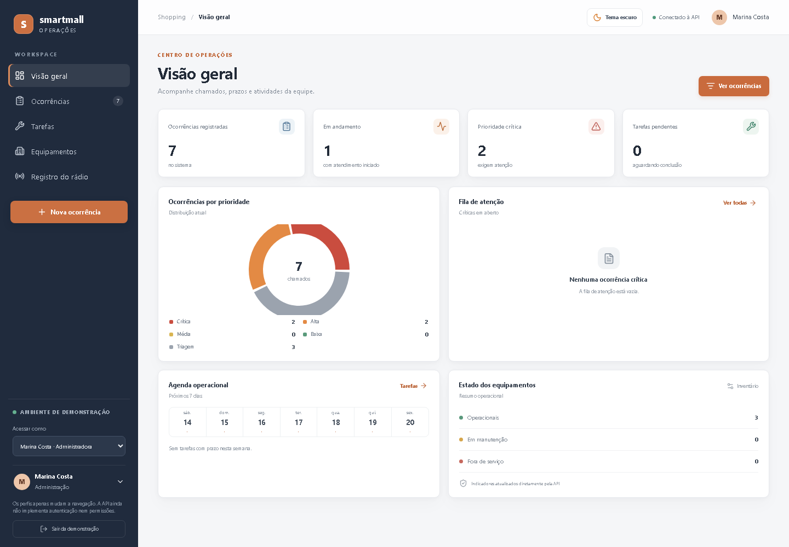

# SmartMall AI

**Para os avaliadores: [todos os links do projeto](links-avaliacao.md)** — site na Vercel, API, Trello, Miro, código-fonte e evidências.

> **Cópia independente — SmartMall-AI-Team.** Administração: [@Setezin7](https://github.com/Setezin7). Código e histórico preservados da organização anterior. Links de PRs, execuções antigas e serviços publicados registram evidências da origem; esses recursos não foram migrados nem recriados por esta cópia. Consulte o [registro da cópia](https://github.com/SmartMall-AI-Team/docs-smartmall-ai/blob/main/copia-team.md).

Gestão de ocorrências operacionais de shopping: do relato ao atendimento, com triagem assistida e revisão humana.

**[Abrir demonstração](https://smartmall-ai-demo.vercel.app)** · **[Guia para a banca](avaliacao.md)** · **[API interativa](https://smartmall-ai-demo-api-8mez.onrender.com/docs)**

## Experimente o ambiente anterior

1. Abra a [demonstração online](https://smartmall-ai-demo.vercel.app).
2. Entre com **usuário `marina` e senha `marina123`** (administração fictícia). Não há código de acesso adicional.
3. Cadastre uma ocorrência fictícia, solicite análise, revise as sugestões e acompanhe tarefas e indicadores.

O serviço gratuito da API pode levar cerca de um minuto para despertar após inatividade. Aguarde **Conectado à API**. Não precisa instalar nada nem criar conta.

Captura do ambiente publicado em 14/11/2026; os indicadores mudam conforme os registros fictícios.

> A demonstração usa dados fictícios compartilhados e **IA simulada**, identificada na tela. Os perfis não implementam autenticação ou permissões reais. Use somente relatos fictícios.

## O que está disponível

| Etapa | Funcionalidades |
| --- | --- |
| Registro | Cadastro, lista, detalhe, busca e filtros rápidos de ocorrências |
| Triagem | Sugestões simuladas, classificação manual e revisão humana explícita |
| Atendimento | Tarefas com responsável, prazo e status; encerramento da ocorrência |
| Acompanhamento | Histórico persistido, equipamentos e dashboard com dados da API |

## Documentação

| Quero consultar… | Documento |
| --- | --- |
| Encontrar os links do projeto | [Links para avaliação](links-avaliacao.md) |
| Avaliar o projeto | [Guia para a banca](avaliacao.md) · [Demonstração passo a passo](demonstracao.md) |
| Entender a proposta | [Escopo e critérios de aceite](escopo.md) · [Arquitetura](arquitetura.md) |
| Conhecer rotas e regras | [Contrato da API](contrato-api.md) |
| Conferir a entrega | [Deploy e evidências](deploy.md) · [Backend](entrega-backend.md) · [Frontend](entrega-frontend.md) |
| Ver próximos passos | [Backlog](backlog.md) · [Validação com usuários](validacao-usuarios.md) |
| Entender esta cópia | [Origem, publicação e verificações da nova organização](copia-team.md) |
| Conhecer a equipe | [Equipe](equipe.md) · [Contribuição](CONTRIBUTING.md) · [Governança](governanca.md) |

## Código e serviços

| Repositório público | Conteúdo | Ambiente anterior (não migrado) |
| --- | --- | --- |
| [fe-smartmall-ai](https://github.com/SmartMall-AI-Team/fe-smartmall-ai) | React, TypeScript e interface | [Site na Vercel](https://smartmall-ai-demo.vercel.app) |
| [be-smartmall-ai](https://github.com/SmartMall-AI-Team/be-smartmall-ai) | FastAPI, SQLAlchemy e migrações | [Swagger no Render](https://smartmall-ai-demo-api-8mez.onrender.com/docs) |
| [docs-smartmall-ai](https://github.com/SmartMall-AI-Team/docs-smartmall-ai) | Requisitos, documentação e evidências | Você está aqui |

Verificação funcional de **14/11/2026**: 55 testes backend aprovados; 12 cenários de navegador aprovados na entrega do ambiente protegido; após retirar o código de acesso, login e recarga novamente aprovados em desktop e celular, com consultas públicas à API. O [guia de deploy](deploy.md) distingue cada verificação. [Actions backend](https://github.com/SmartMall-AI-Team/be-smartmall-ai/actions) · [Actions frontend](https://github.com/SmartMall-AI-Team/fe-smartmall-ai/actions).

## Verificação na organização nova

A cópia foi publicada com histórico e autoria preservados. Os novos CIs aprovaram **55 testes backend** e **12 cenários do frontend**, além do build. Veja os [PRs, checks e proteções configurados](copia-team.md). Os ambientes de nuvem e os quadros de planejamento não foram transferidos.

## Limites e organização

A integração OpenAI está implementada e testada com respostas controladas; a chamada real depende de saldo e validação. Autenticação individual, autorização por perfil, filtros adicionais, edição de responsável/prazo e sessões com usuários continuam pendentes. O rádio aceita anotações digitadas, sem captura de áudio ou transcrição. Redução de tempo de atendimento é uma hipótese ainda sem medição.

**Liderança e backend:** [João Geraldo — @Setezin7](https://github.com/Setezin7). A [equipe](equipe.md) tem quatro integrantes; as demais frentes ainda estão em definição.

O [Trello](https://trello.com/b/TMJ0EfTl) é privado e complementar: os materiais públicos acima permitem consultar a entrega. O [Miro](https://miro.com/app/board/uXjVEOPHRG4=/?share_link_id=465697087214) registra o planejamento inicial. A [organização SmartMall-AI-Team](https://github.com/SmartMall-AI-Team) reúne os links principais.
